# ha-speedtest-card

[](https://www.home-assistant.io/integrations/marketplace/)
[](https://github.com/juju35/ha-speedtest-card/actions/workflows/hacs.yml)
[](https://github.com/juju35/ha-speedtest-card/actions/workflows/validate.yml)
[](https://github.com/juju35/ha-speedtest-card/actions/workflows/lint.yml)
[](https://github.com/juju35/ha-speedtest-card/releases/latest)
[](https://github.com/juju35/ha-speedtest-card/blob/main/LICENSE)
[](https://buymeacoffee.com/julienstep9)

<p align="center"></p>

<p align="center">
  &nbsp;&nbsp;
  &nbsp;&nbsp;
  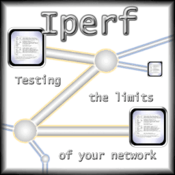&nbsp;&nbsp;
  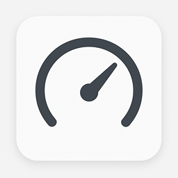&nbsp;&nbsp;
  &nbsp;&nbsp;
  
</p>

Lovelace cards for Home Assistant for your **internet speed tests**: a **gauge** of the download speed against your plan, the **upload**, **ping**, **jitter** and **packet loss**, a **7-day history** read from the recorder with your plan's line and the **slowest test**, and a button that **runs a test**, from [Speedtest.net](https://www.home-assistant.io/integrations/speedtestdotnet/), [Fast.com](https://www.home-assistant.io/integrations/fastdotcom/), [iperf3](https://www.home-assistant.io/integrations/iperf3/), [Ookla Speedtest](https://github.com/soulripper13/hass-speedtest-ookla), [Speedtest Tracker](https://github.com/metaathron/ha-speedtest-tracker) or a [Netgear](https://www.home-assistant.io/integrations/netgear/) router's speed test.

The sensors are **discovered automatically** from the Home Assistant entity and device registries: an empty configuration already shows your speed test, whatever your Home Assistant language or entity ids. Any download, upload and ping sensors can also be set in the configuration.

[](https://my.home-assistant.io/redirect/marketplace_repository/?owner=juju35&repository=ha-speedtest-card&category=plugin)

| Speedtest Card | Speedtest Mini Card |
|---|---|
| 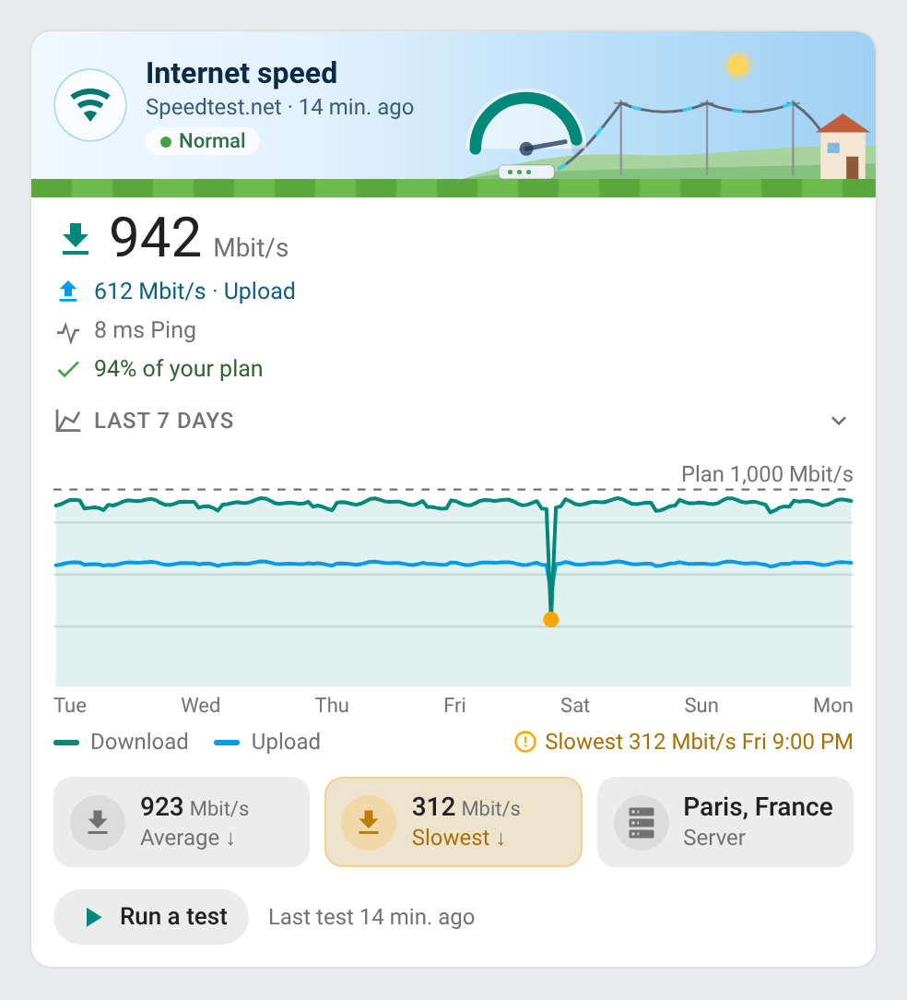 | 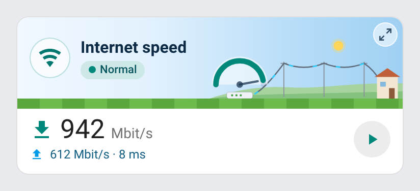<br>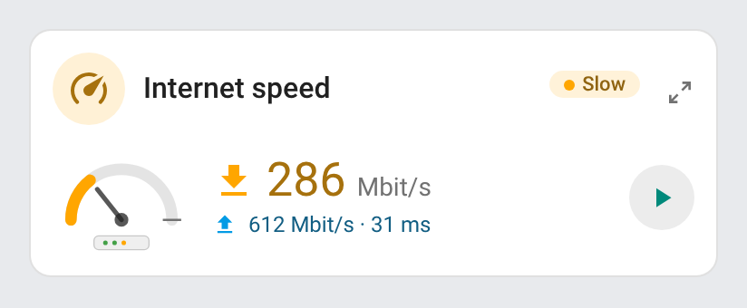 |

## Features

- Two cards: a full **Speedtest Card** (`custom:speedtest-card`) and a compact **Speedtest Mini Card** (`custom:speedtest-mini-card`)
- **Illustrated header** (90 px, full and mini card): the title on the sky, the card's gauge on a lawn with a fibre line on poles running to a house; light pulses run along the line (fast while a test runs, sparse and amber when the line is slow, none without a result). Day or night picture from `sun.sun` (else the dark theme), forced with `illustration_theme`; `illustration: false` brings back the classic header
- **Download gauge**, drawn as an illustration: a half dial filled up to your plan's speed (`plan_download`, marked on the dial; without a plan, a round scale above the week's best) with its needle, the speed in large next to it
- **Upload, ping, jitter and packet loss** in colored lines beside it, when the integration gives them, and the **share of your plan** reached
- **History** of the last 7 days (`history_days`) from the recorder: download and upload lines, your plan as a dashed line, the **slowest test** marked and named ("Slowest 312 Mbit/s Fri 9:00 PM")
- Average and slowest download of the period, the test **server** (and the provider, when known) as tiles; the slowest is tinted when it is slow
- **Run a test** button, each integration its own way (see [Running a test](#running-a-test)); while a test runs, the needle sweeps the dial and the box's light blinks until the new result comes in (see [Animations](#animations))
- Status chip under the title (on the title's line in the classic header): **Normal**, **Slow** (under half of the plan, or of the week's median without a plan; `alert_ratio`), **High latency** (`ping_alert`), **Testing…**, **No result**
- Header icon in a tinted round badge, in the colour of the status; the subtitle says which service measured and when
- Collapsible history section, folded back to its default by a click elsewhere on the page
- Click any value to open its Home Assistant history (more-info dialog)
- Detail button on the mini card (top right): it switches the mini card to the full card's content and back; a click anywhere outside the card brings the compact view back
- Visual editor in the dashboard UI for both cards (no YAML needed)
- Light and dark mode, English, French, German, Spanish, Serbian (Cyrillic and Latin), Italian, Dutch, European Portuguese, Polish, Romanian, Danish, Swedish, Bulgarian, Russian, Ukrainian, Hungarian, Slovak, Czech, Slovenian, Latvian and Greek
- Single file, no external dependency

## Supported integrations

| Integration | What the cards use |
|---|---|
|  [Speedtest.net](https://www.home-assistant.io/integrations/speedtestdotnet/) (core) | Download, upload and ping sensors, the server (`server_name`, `server_country`); a test with `homeassistant.update_entity` |
|  [Fast.com](https://www.home-assistant.io/integrations/fastdotcom/) (core) | Download sensor; a test with `homeassistant.update_entity` |
|  [iperf3](https://www.home-assistant.io/integrations/iperf3/) (core) | Download and upload sensors of the first host; a test with `iperf3.speedtest` |
|  [Ookla Speedtest](https://github.com/soulripper13/hass-speedtest-ookla) (custom, `ookla_speedtest`) | Download, upload, ping, jitter, server, ISP; a test with `ookla_speedtest.run_speedtest` |
|  [Speedtest Tracker](https://github.com/metaathron/ha-speedtest-tracker) (custom, `speedtest_tracker`) | Download, upload, ping, jitter, packet loss, server, last test time; a test with its *Run test* button |
|  [Netgear](https://www.home-assistant.io/integrations/netgear/) (core) | The router's speed test: *Downlink bandwidth*, *Uplink bandwidth* and *Average ping* (not its traffic counters); a test with `homeassistant.update_entity` |
| Any sensors | `download` (and `upload`, `ping`, `jitter`) in the configuration, in any data rate unit of Home Assistant (bit/s to Gbit/s, B/s to GB/s, KiB/s to GiB/s); a test with `button` |

When several are installed, the first in this order is used: Speedtest Tracker, Ookla Speedtest, Speedtest.net, Fast.com, iperf3, Netgear (`device` picks one device by its name). Details in [How it works](#how-it-works).

## Prerequisites

Home Assistant 2024.8 or later with the recorder (for the history), and one of the integrations above (or download sensors of your own).

## Installation

### Via the Marketplace (recommended)

Click the button below to add the repository directly:

[](https://my.home-assistant.io/redirect/marketplace_repository/?owner=juju35&repository=ha-speedtest-card&category=plugin)

Then click **Install**, and reload your browser when the Marketplace asks you to.

Or manually:

1. Open **Settings → Marketplace → Add from link** (top right; this needs a GitHub account connected)
2. Add `https://github.com/juju35/ha-speedtest-card` — Type: **Dashboard**
3. Open **Speedtest Card** and click **Install**
4. Clear your browser cache and refresh

The Marketplace adds the resource `/local/community/ha-speedtest-card/speedtest-card.js` for you.

### Manual

1. Download `speedtest-card.js` and the `speedtest-card.i18n.*.js` translation files from the [latest release](https://github.com/juju35/ha-speedtest-card/releases/latest)
2. Copy them all to `/config/www/` (without the translation files, the cards show in English)
3. Go to **Settings → Dashboards → ⋮ → Resources** → Add resource:
   - URL: `/local/speedtest-card.js`
   - Type: **JavaScript Module**
4. Clear your browser cache and refresh

## Configuration

### Card types

| Card | Type |
|---|---|
| Speedtest Card | `custom:speedtest-card` |
| Speedtest Mini Card | `custom:speedtest-mini-card` |

### Visual editor

Edit a dashboard, click **Add card** and search for **Speedtest Card** or **Speedtest Mini Card**. Everything is discovered when the fields are left empty; pick the download, upload and ping sensors or the run button to use those, set your plan's speeds, the length of the history and the alert thresholds, the sections and the language. The preview updates live, and options left at their default are kept out of the generated YAML.

### Minimal

```yaml
type: custom:speedtest-card
```

```yaml
type: custom:speedtest-mini-card
```

### Full options

```yaml
type: custom:speedtest-card
title: Fibre
device: Speedtest.net
download: sensor.speedtest_download
upload: sensor.speedtest_upload
ping: sensor.speedtest_ping
jitter: sensor.speedtest_jitter
button: button.speedtest_tracker_run_test
plan_download: 1000
plan_upload: 700
history_days: 7
alert_ratio: 0.5
ping_alert: 100
illustration: true
illustration_theme: auto
show_title: true
show_subtitle: true
show_history: true
show_stats: true
show_run: true
collapsed:
  - history
language: en
```

```yaml
type: custom:speedtest-mini-card
plan_download: 1000
zoom: true
```

### Options reference

| Option | Card | Default | Description |
|---|---|---|---|
| `title` | both | Internet speed | Card title |
| `illustration` | both | `true` | Illustrated header (sky, gauge, fibre line, house on a lawn strip); `false` shows the classic header |
| `illustration_theme` | both | `auto` | Picture of the illustrated header: `auto` (night when `sun.sun` is below the horizon, else with the dark theme), `day` or `night` |
| `show_title` | both | `true` | Show the title in the header |
| `show_subtitle` | full | `true` | Show the subtitle (the service and when it measured) |
| `device` | both | First found | Device (its name or id) of a supported integration, when you have several |
| `download` | both | Automatic | Download speed sensor; set, the card uses it and finds the others on its device |
| `upload`, `ping`, `jitter` | both | Automatic | Upload speed, ping and jitter sensors |
| `button` | both | Automatic | Button that runs a test (Speedtest Tracker's *Run test* is found on its own) |
| `plan_download` | both | — | Download speed of your plan, in Mbit/s: the top of the gauge, a line on the history, the reference of *Slow* |
| `plan_upload` | both | — | Upload speed of your plan, in Mbit/s |
| `history_days` | both | `7` | Length of the history, in days |
| `alert_ratio` | both | `0.5` | *Slow* under this share of the plan (or of the median of the history without a plan) |
| `ping_alert` | both | `100` | *High latency* from this ping, in ms |
| `show_history` | both | `true` | History section |
| `show_stats` | both | `true` | Average, slowest and server tiles |
| `show_run` | both | `true` | Run a test button |
| `collapsed` | both | `[]` | Sections folded by default: `history`. Click its title (or Tab to it and press Enter or Space) to fold or unfold it |
| `zoom` | mini | `true` | Detail button at the top right of the mini card: it shows the full card's content (with the same options, which can be set on the mini card too, in its visual editor as well) and switches back to the compact view; a click outside the card also brings the compact view back. `false` removes the button |
| `language` | both | Auto | Force language: `fr`, `en`, `de`, `es`, `sr`, `sr-Latn`, `it`, `nl`, `pt`, `pl`, `ro`, `da`, `sv`, `bg`, `ru`, `uk`, `hu`, `sk`, `cs`, `sl`, `lv` or `el` (auto-detects from HA settings) |

### Running a test

| Integration | Call |
|---|---|
| With `button`, or Speedtest Tracker | `button.press` on the button |
| Ookla Speedtest | `ookla_speedtest.run_speedtest` with the download sensor as `entity_id` (only that test runs) |
| iperf3 | `iperf3.speedtest` |
| Speedtest.net, Fast.com, Netgear | `homeassistant.update_entity` on the download sensor (the integration measures again) |

The card shows *Testing…* until the download sensor reports a new result (90 seconds at most).

## Screenshots

### Animations

While a test runs, the needle sweeps the dial back and forth, the box's light blinks, light pulses race along the fibre line of the header and the button's icon turns; the animation honours `prefers-reduced-motion`:

| Light | Dark |
|---|---|
| 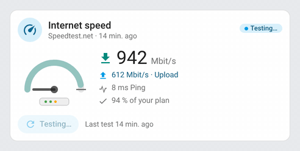 | 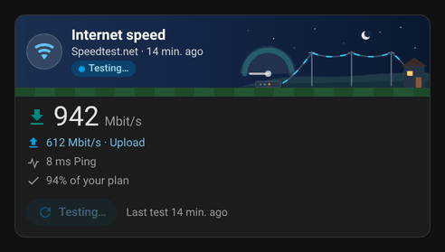 |

### Full card

A 1 Gbit/s fibre plan: the last test is normal, one slow test on Friday evening:

| Light | Dark |
|---|---|
|  | 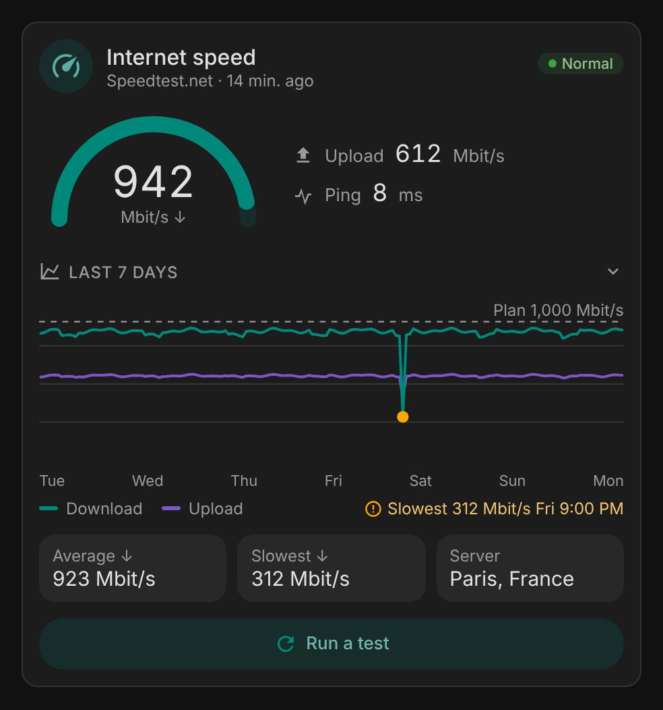 |

The last test is slow, well under the plan:

| Light | Dark |
|---|---|
| 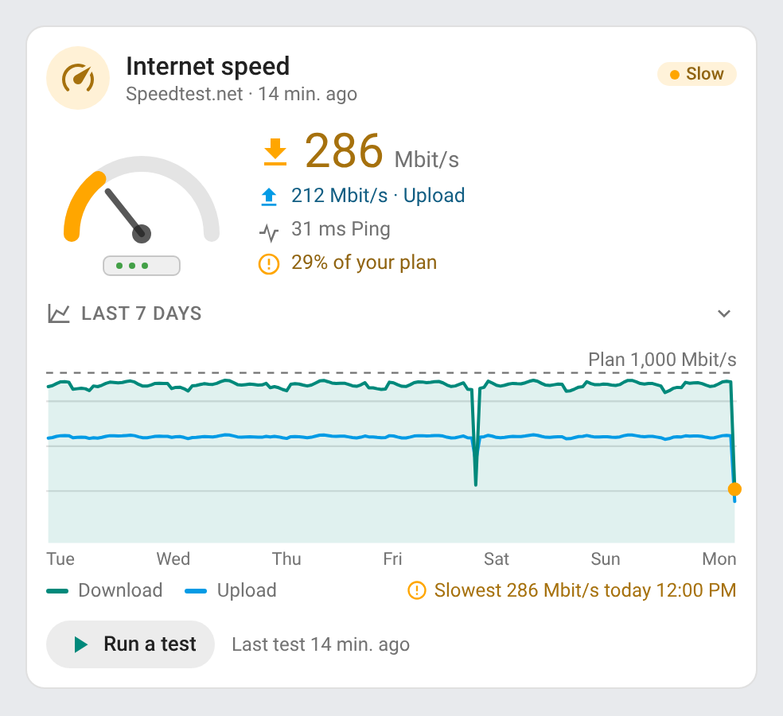 | 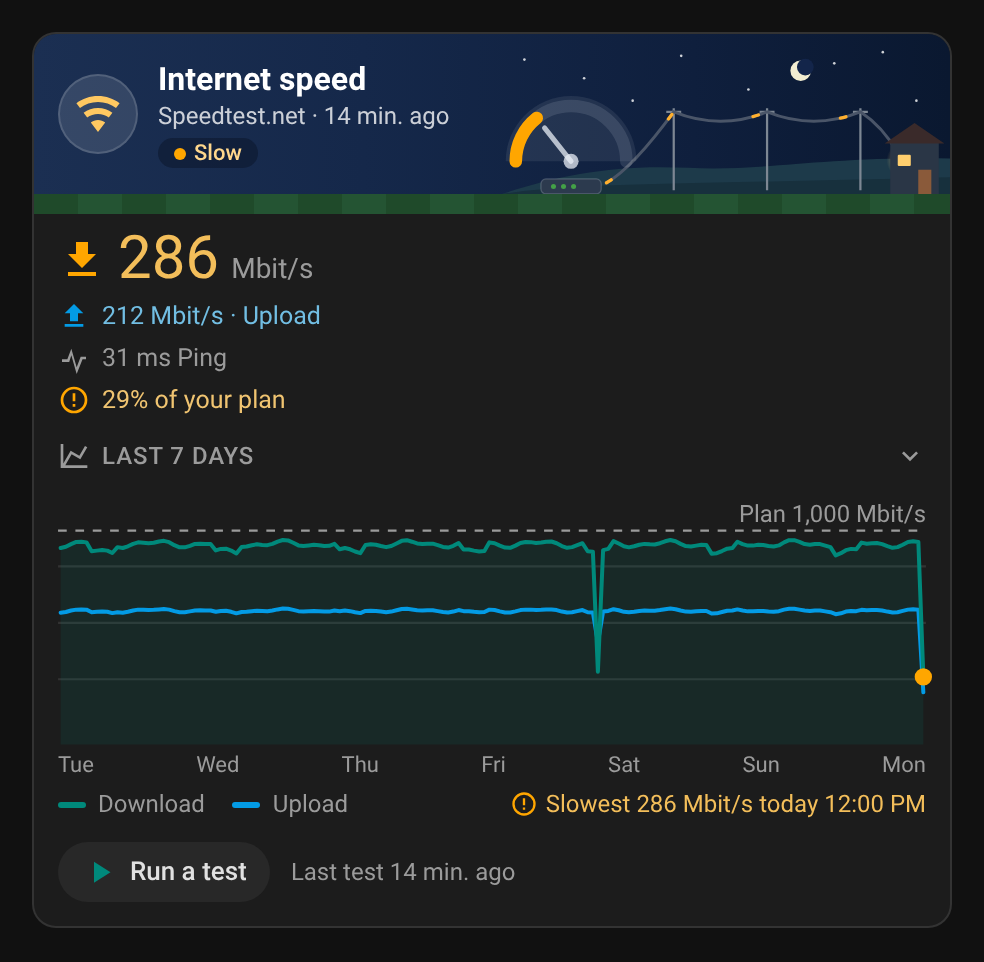 |

### Mini card

| Light | Dark |
|---|---|
|  | 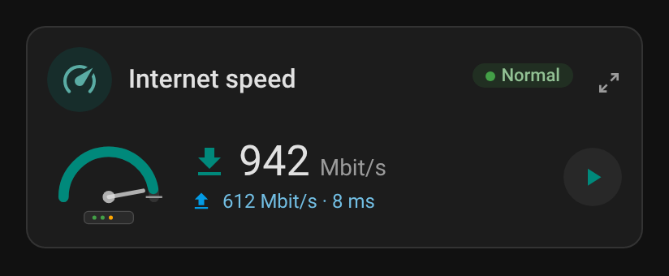 |
|  | 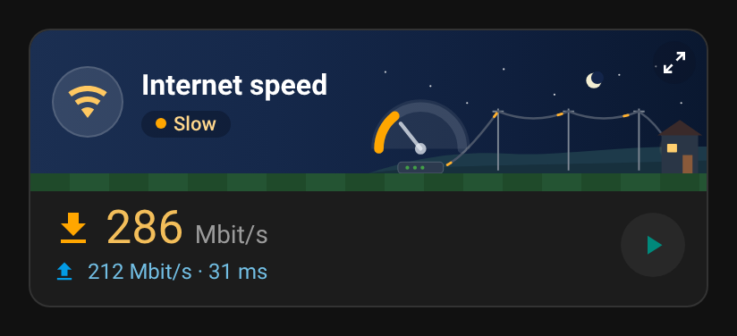 |

The detail button (top right) shows the full card's content:

| Light | Dark |
|---|---|
| 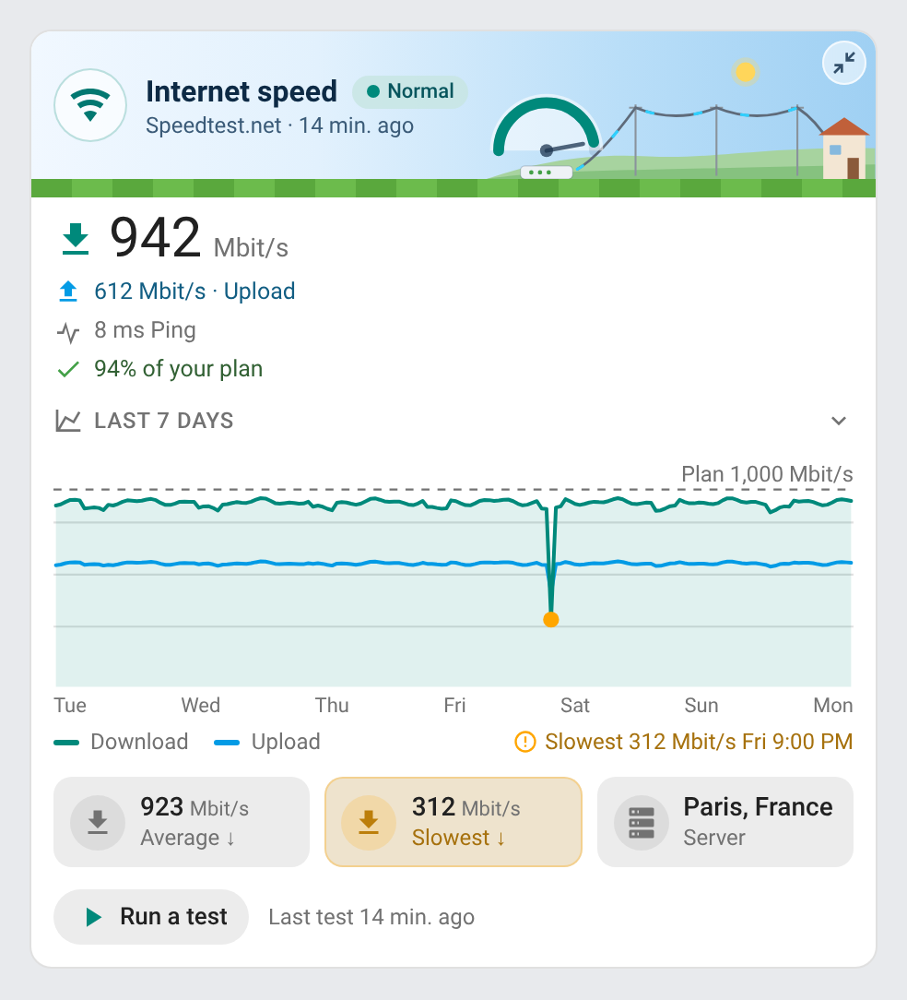 | 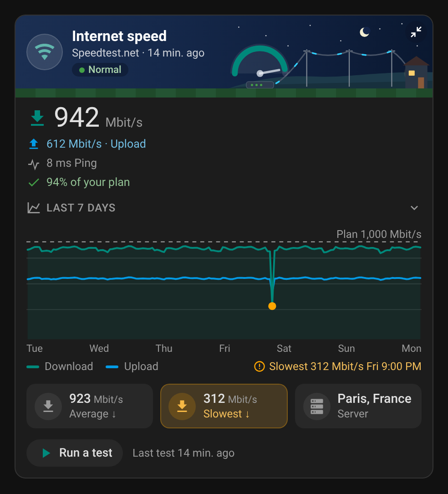 |

### Narrow cards

The full card at 6 columns of a phone's Sections view (the gauge above its values) and the mini card at its minimum width:

| Light | Dark |
|---|---|
| 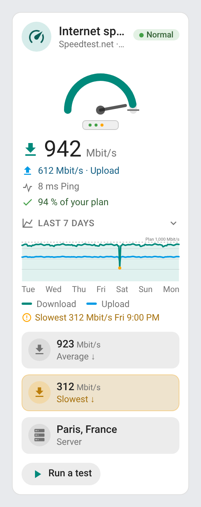 | 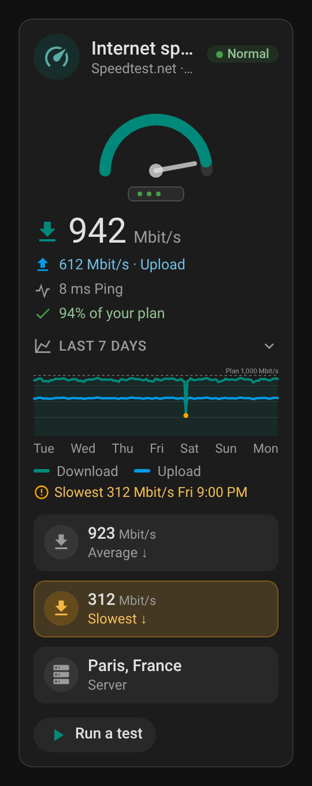 |
| 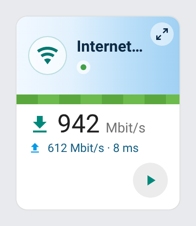 | 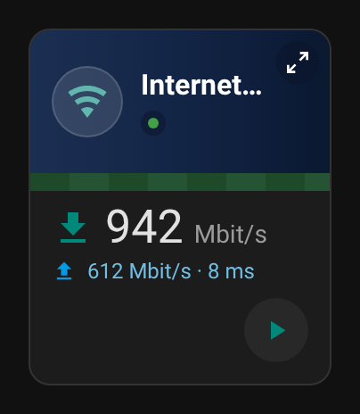 |

## How it works

The cards read the Home Assistant entity and device registries instead of relying on entity ids: the sensors of a speed test are those of the integration's device, recognised by their translation key or name (*download*, *upload*, *ping*, a Netgear router's *downlink* / *uplink bandwidth* and *average ping*, *jitter*, *packet loss*, *server*, *ISP*, *last test*; not the latency, average or minimum variants). Entity ids can therefore be in any language or renamed.

- **Units**: speeds are converted to Mbit/s from the sensor's unit (bit/s, kbit/s, Mbit/s, Gbit/s, B/s, kB/s, MB/s, GB/s, KiB/s, MiB/s, GiB/s).
- **History**: the card asks the recorder (`history/history_during_period`) for the download and upload sensors over `history_days`, again after each new result and every hour. The slowest test of the period is marked when it is under `alert_ratio` of the plan (or of the median).
- **Status**: *Slow* compares the last download with the plan (or the median of the history), *High latency* the last ping with `ping_alert`.

## Development

```bash
npm install
npm run build        # bundles src/speedtest-card.js into dist/speedtest-card.js (and its translation files)
npm run check        # builds and checks the card (run in CI)
npm test             # unit tests
npm run screenshots  # renders the cards (and one GIF per animated state, needs ffmpeg) with mock data into screenshots/
```

`dist/` is not committed: `npm run build` creates it locally, CI builds it on every push, and the release workflow attaches the built files to the release, which is where the Marketplace installs it from. The captures are rendered on a fixed clock with mock data (scripts/mock-states.mjs) and rewritten only when their pixels change, exactly; on a pull request, the **Screenshots** workflow commits them to the pull request's branch.

### Releasing

1. Bump `version` in `package.json` (and `package-lock.json`, with `npm install`)
2. Add a `## <version>` section at the top of [CHANGELOG.md](https://github.com/juju35/ha-speedtest-card/blob/main/CHANGELOG.md)
3. Push to `main`: the **Release** workflow builds the card, creates the tag and the GitHub release with the changelog section as notes, and attaches `speedtest-card.js` and its translation files

## Translations

The cards auto-detect the language from your Home Assistant settings. Currently supported:

| Language | Code |
|---|---|
| English | `en` |
| Français | `fr` |
| Deutsch | `de` |
| Español | `es` |
| Српски | `sr` |
| Srpski (latinica) | `sr-Latn` |
| Italiano | `it` |
| Nederlands | `nl` |
| Português (European; also used for `pt-BR`) | `pt` |
| Polski | `pl` |
| Română | `ro` |
| Dansk | `da` |
| Svenska | `sv` |
| Български | `bg` |
| Русский | `ru` |
| Українська | `uk` |
| Magyar | `hu` |
| Slovenčina | `sk` |
| Čeština | `cs` |
| Slovenščina | `sl` |
| Latviešu | `lv` |
| Ελληνικά | `el` |

English is in the card's file; every other language is in its own small file (`speedtest-card.i18n.<lang>.js`), loaded only when needed. Contributions for additional languages are welcome!

## Credits

Speedtest and Ookla are trademarks of Ookla, LLC; Fast.com is a trademark of Netflix, Inc.; NETGEAR is a trademark of NETGEAR, Inc. This project is not affiliated with any of them. Icons from [Material Design Icons](https://pictogrammers.com/library/mdi/).

## License

[MIT](https://github.com/juju35/ha-speedtest-card/blob/main/LICENSE)

## Support

If you find this project useful, you can support its development:

<a href="https://buymeacoffee.com/julienstep9"></a>
